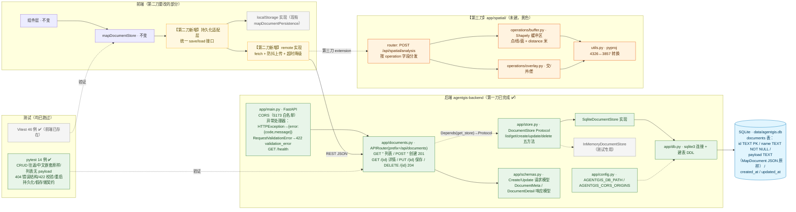

# AgentGIS 前后端详细架构（2026-11-19 现状）

> 前端 = `agentgis-frontend`（已完成阶段 1 收敛 + 阶段 2 测试）；后端 = `agentgis-backend`（阶段 3 第一刀已完成：文档 CRUD）。
> 两张图：① 前端全模块细图（组件 → store → 纯函数 → 持久化）；② 后端细图 + 前后端数据流与阶段 3 剩余两刀的位置。

## 一、前端全模块细图

```mermaid
flowchart TB
    subgraph ENTRY["入口与路由"]
        E1["index.html → src/main.ts（createApp + Pinia + router）"]
        E2["src/router.ts · hash 模式 · /map /project /data → AppLayout"]
        E3["src/layouts/AppLayout.vue · CSS 1039px 断点切换桌面/移动"]
        E1 --> E2 --> E3
    end

    subgraph COMP["components/（纯展示 + 事件上抛，五个分组）"]
        direction TB
        subgraph SHELL["shell/"]
            C1["DesktopShell · 三栏组合"]
            C2["AppNavRail · 地图/项目/数据 + 账户"]
            C3["DesktopLeftPane → WorkspaceSidebar"]
            C4["DesktopMainArea · 挂地图区与检查器"]
            C5["WorkspaceHeadActions · 折叠左/右栏"]
        end
        subgraph MAPG["map/"]
            C6["MapWorkspace · 组合画布+命令栏"]
            C7["AmapBaseMap · 高德加载/绘制/编辑编排（491 行）"]
            C8["MapCommandBar → MapModeSelector → MapModeTools"]
            C9["MapDrawingDock · 绘制参数坞"]
            C10["MapBoundsFrame · 视口边框 / MapViewControls"]
        end
        subgraph PANG["panels/"]
            C11["MapDocumentList · 项目列表（新建/改名/删除/打开）"]
            C12["LayerImageResourcesPanel · 图层图片资源"]
            C13["GeoJsonTransferPanel · 导入导出"]
        end
        subgraph INSP["inspector/"]
            C14["InspectorPanel · 要素/操作 两页签容器"]
            C15["InspectorSearch · 图层/要素搜索"]
        end
        subgraph DLGG["dialogs/"]
            C16["AccountModal · BYOK 高德 Key（settingsStore）"]
            C17["DraftMapSaveDialog · 草稿另存为"]
        end
        subgraph SHR["shared/（10 个通用组件）"]
            C18["LayerFeatureTree · 图层树+要素列表"]
            C19["FeaturePropertyTable · 属性表（自由结构）"]
            C20["LayerCreateDialog · ConfirmActionDialog · TextInputDialog"]
            C21["OperationHistoryPanel → OperationStack → OperationCard"]
            C22["CommitCard · ExternalOperationCard（外部操作审核）"]
        end
        subgraph MOBG["mobile/"]
            C23["MobileShell · 四 tab（地图/项目/数据/我的）"]
            C24["MobileBottomNav"]
        end
    end
    E3 --> C1
    E3 --> C23

    subgraph STATE["stores/（只编排，不计算）"]
        S1["mapDocumentStore · 1062 行 · 38 个公开动作"]
        S1A["文档动作：createMap/renameMap/deleteMap/saveDraftAsMap/setActiveDocument/resetDraft·Document"]
        S1B["图层动作：createLayer/renameLayer/deleteLayer/reorderLayers/setLayerVisible/selectLayer"]
        S1C["要素动作：addFeature/updateFeatureProperties/updateFeatureGeometry/renameFeature/deleteFeature/selectFeature"]
        S1D["历史动作：undo/redo/commitWorkingOperations"]
        S1E["数据动作：importGeoJson/exportGeoJson"]
        S1F["外部操作：add/match/apply/remove/clear（AI 预留管道）"]
        S1G["内部机制：updateActiveDocument → appendOperations → createOperation → persistAndReturn"]
        S2["settingsStore · BYOK 开关/Key/LLM 占位字段"]
        S1 --- S1A & S1B & S1C & S1D & S1E & S1F & S1G
    end
    C1 & C11 & C13 & C14 & C18 & C19 & C23 --> S1
    C16 --> S2

    subgraph PURE["shared/mapDocument/ ×14（纯函数，全部有测试路径）"]
        P1["mapDocumentUndoRedo · 55 行 · 双栈移动"]
        P2["mapDocumentOperationApply · 232 行 · apply/revert 7 种操作"]
        P3["mapDocumentEditOperations · 313 行 · compactOperations 合并/湮灭"]
        P4["mapDocumentMutations · 258 行 · 图层/要素增删改/选择/排序"]
        P5["mapDocumentDeletion · 64 行 · 删图层/要素级联"]
        P6["mapDocumentGeoJson · 188 行 · import 自动分层/export 筛选"]
        P7["mapDocumentCollection · 195 行 · 草稿/地图集合/空编辑态"]
        P8["mapDocumentDraftValidation · 224 行 · 草稿几何校验（类型/自相交/面积）"]
        P9["mapDocumentValidation/EditValidation · 校验输入与操作一致性"]
        P10["mapDocumentEditState · 由 EditValidation 校验双栈+提交+外部操作"]
        P11["mapDocumentExternalOperations · 131 行 · 外部操作匹配内部历史"]
        P12["mapDocumentMigration · 437 行 · 旧存储版本迁移+备份"]
        P13["mapDocumentPersistence · 172 行 · localStorage 读写（阶段 3 改造点）"]
        P14["mapDocumentConstants · 3 个固定 id"]
    end
    S1 --> P1 & P2 & P3 & P4 & P5 & P6 & P7
    C7 --> P8
    S1 --> P11
    P13 --> P12

    subgraph AMAP["shared/amap/ ×4 + shared/map/ ×2（高德隔离层）"]
        A1["amapLoader · SDK 动态加载+类型"]
        A2["amapDrawingSession · 绘制状态机"]
        A3["amapEditSession · 几何编辑会话"]
        A4["amapDraftGeometry · 草稿几何转换"]
        A5["amapFeatureAdapter · Store ↔ 覆盖物双向绑定"]
        A6["useGeometryEditTarget · 编辑目标计算（双端复用）"]
    end
    C7 --> A1 & A2 & A3 & A4 & A5 & A6

    subgraph SCHEMA["schemas/mapDocumentSchema.ts · 261 行 · Zod 单一真相源"]
        Z1["MapDocumentState · workspace/draft/documentsById/activeRef"]
        Z2["MapLayer · geometryType/role/featureIds/style/imageResources"]
        Z3["MapFeature · geojson(自由 properties) / imageResourceId"]
        Z4["MapOperation ×7 · discriminatedUnion"]
        Z5["EditState · working/redo 双栈 + commitPool（待同步）+ externalOperations"]
    end
    P1--P14 --> SCHEMA

    LS[("localStorage · agentgis:v9_3:map-document-state<br/>+ 旧键迁移备份 + settings 键")]
    P13 --> LS

    subgraph TESTS["__tests__/ · Vitest 46 例"]
        T1["mapDocumentUndoRedo.test · 9 例"]
        T2["mapDocumentEditOperations.test · 16 例"]
        T3["mapDocumentGeoJson.test · 21 例"]
        T4["fixtures.ts · 共用夹具"]
    end
    P1 --> T1
    P3 --> T2
    P6 --> T3

    classDef ui fill:#ffffff,stroke:#9e9e9e,color:#333;
    classDef state fill:#e3f2fd,stroke:#1565c0,color:#0d3c61;
    classDef pure fill:#e8f5e9,stroke:#2e7d32,color:#1b4d22;
    classDef test fill:#f3e5f5,stroke:#7b1fa2,color:#3d1450;
    classDef store0 fill:#fff8e1,stroke:#f9a825,color:#5d4a00;
    class C1,C2,C3,C4,C5,C6,C7,C8,C9,C10,C11,C12,C13,C14,C15,C16,C17,C18,C19,C20,C21,C22,C23,C24 ui;
    class S1,S2 store0;
    class P1,P2,P3,P4,P5,P6,P7,P8,P9,P10,P11,P12,P13,P14 pure;
    class Z1,Z2,Z3,Z4,Z5,A1,A2,A3,A4,A5,A6,S1A,S1B,S1C,S1D,S1E,S1F,S1G state;
    class T1,T2,T3,T4 test;
```

## 二、后端细图 + 前后端数据流（含阶段 3 剩余两刀）

## 三、旧后端 rag-agent v0.7 全模块细图（历史参考，不复活）

```mermaid
flowchart TB
    subgraph ENTRY["入口 app/main.py · 106 行"]
        M0["FastAPI · CORS 全开 · 静态托管 frontend/dist<br/>POST /api/retrieve（RAG 检索兼容端点）"]
    end

    subgraph APIL["api/ · 驱动适配器（4 路由 + 依赖注入 403 行）"]
        direction TB
        A1["project_api · 71 行<br/>GET/POST /projects · GET/PUT/DELETE /projects/{id}"]
        A2["map_api · 220 行<br/>POST /map/edit · /map/analyze-chat<br/>/map/import-amap · /map/reference-amap · GET /health"]
        A3["agent_api · 23 行<br/>POST /agent/run"]
        A4["chat_api · 32 行<br/>v0.7 新增"]
        A5["dependencies · 57 行<br/>DI 组装 EditMapService / JsonProjectStore"]
    end
    M0 --> A1 & A2 & A3 & A4
    A5 -.注入.-> A2

    subgraph SVC["services/ · 用例层（18 文件约 5100 行）"]
        direction TB
        subgraph AGENT["Agent 链路（红色=已放弃）"]
            S1["agent_graph · 581 行<br/>LangGraph StateGraph 8 节点<br/>load→context→intent→retrieval→workflow→persist→memory→final"]
            S2["agent_intent · 320 行<br/>LLM+规则双通道 6 意图分类"]
            S3["context_composer · 276 行<br/>4 模式上下文组装"]
        end
        subgraph EDIT["编辑链路（黄色=部分可借鉴）"]
            S4["edit_map_service · 541 行<br/>analyze/edit/import 三入口编排"]
            S5["llm_map_editor · 544 行<br/>LLM 生成 EditPlan"]
            S6["operation_executor · 347 行<br/>7 种 op 应用+校验（create_layer/add_features/draw_circle…）"]
            S7["amap_importer · 295 行<br/>高德 POI 抓取→MapFeature"]
            S8["geo_retrieval · 305 行<br/>空间检索工具包（bbox/附近/图层）"]
        end
        subgraph MEM["记忆系统（红色=已放弃）"]
            S9["conversation_memory · 163 行<br/滚动摘要 3500字→1800字"]
            S10["memory_manager · 376 行<br/>三层记忆读写编排"]
            S11["memory_extractor · 216 行<br/>LLM 提取 6 类记忆候选"]
            S12["memory_policy · 145 行<br/>置信度策略/去重/衰减"]
        end
        S13["map_brief · 65 行<br/>地图摘要生成"]
        S14["map_context · 210 行<br/>上下文快照"]
        S15["mappers · 63 行<br/>schema↔dataclass 转换"]
        S16["document_service · 180 行<br/>文档管理"]
        S17["indexing_service · 255 行<br/>入库/切块/嵌入编排"]
        S18["query_service · 126 行<br/>RAG 查询编排"]
        S19["eval_service · 72 行<br/>检索评估"]
        S20["trace_service · 52 行<br/>调用追踪"]
    end
    A3 --> S1
    A2 --> S4
    A1 --> S16
    A2 --> S7
    S1 --> S2 & S8 & S10 & S17
    S4 --> S5 & S6 & S7
    S5 --> S2
    S10 --> S9 & S11 & S12

    subgraph DOM["domain/ · 领域核心（90 行，唯一干净的六边形部分）"]
        D1["map_document · 56 行<br/>MapDocument/Layer/Feature/Geometry/Viewport（dataclass 零依赖）"]
        D2["operations · 34 行<br/>MapOperation/OperationResult/EditPlan/EditStep"]
    end
    S6 --> D1 & D2

    subgraph ADAPT["adapters/ · 驱动适配器（642 行）"]
        AD1["llm_client · 113 行<br/>OpenAI 兼容 complete_json()"]
        AD2["json_project_store · 341 行<br/>项目整体存 JSON 文件·锁·workspace 过滤（绿色=策略可借鉴）"]
        AD3["amap_adapter · 188 行<br/>httpx 高德 geocode/POI/周边（绿色=阶段 5 复用）"]
    end
    S5 & S2 & S11 --> AD1
    S10 & S1 --> AD2
    S7 --> AD3

    subgraph RAGL["RAG 链路（红色=已放弃）"]
        direction TB
        P1["processing/ · 6 文件<br/>loader/chunker/cleaner/differ/embedder/keyword_extractor"]
        R1["retrieval/ · 6 文件<br/>dense/sparse/fusion(RRF)/query_processor/query_rewriter/reranker"]
        T1["tools/rag_toolkit · 检索门面"]
        ST1["storage/ · 4 文件<br/>qdrant_store/chunk_reconstructor/document_registry/file_store"]
        QD2[("qdrant_data/ 本地向量库<br/>BGE-small-zh + bge-reranker 本地模型")]
    end
    S17 --> P1
    S18 --> R1
    M0 --> T1
    T1 --> R1
    S1 --> T1
    P1 --> ST1
    R1 --> ST1
    ST1 --> QD2

    subgraph SCH2["schemas/ · Pydantic DTO（7 文件）"]
        SC1["agent · edit · geo_retrieval · map_document<br/>project · query_base · reference_data"]
    end
    SVC --> SCH2
    ADAPT --> SCH2

    FS[("data/documents/projects.json<br/>整文件 JSON 存储 + 线程锁")]
    AD2 --> FS

    JUDGE2["裁决：绿色=借鉴（CRUD 形状 / 列表-详情分离 / amap_adapter / operation_executor 的圆形缓冲算法）<br/>红色=放弃（LangGraph 8 节点 / 三层记忆 / RAG+Qdrant+BGE / eval/trace）<br/>黄色=部分参考（llm_map_editor 的 EditPlan 模式 → 我们未来的 AI 薄接口）"]
    RAGL ~~~ JUDGE2

    classDef cut2 fill:#fbe9e7,stroke:#c62828,color:#5d1a12;
    classDef keep2 fill:#e8f5e9,stroke:#2e7d32,color:#1b4d22;
    classDef mid2 fill:#fff8e1,stroke:#f9a825,color:#5d4a00;
    classDef dom2 fill:#e3f2fd,stroke:#1565c0,color:#0d3c61;
    class S1,S2,S9,S10,S11,S12,P1,R1,T1,ST1,QD2 cut2;
    class AD2,AD3 keep2;
    class S4,S5,S6,S7 mid2;
    class D1,D2 dom2;
```

### 旧后端关键数字与归宿

| 部分 | 行数 | 归宿 |
|---|---|---|
| api/ 路由层 | 403 | `project_api` 的 CRUD 形状 → 我们 `documents.py` 已复刻；`dependencies.py` 的 DI 思路 → 我们 `Depends(get_store)` |
| domain/ | 90 | 纯 dataclass 模型，与前端 Zod 不兼容，**不迁移**；但其"domain 零外部依赖"原则我们照做 |
| adapters/ | 642 | `json_project_store` 的列表-详情分离、workspace 过滤 → 策略借鉴；`amap_adapter` → 阶段 5 演示数据抓取可直接搬（独立文件，无依赖牵涉） |
| services/ Agent+记忆 | 约 2400 | **全部放弃**（LangGraph、6 意图分类、三层记忆、滚动摘要） |
| services/ 编辑链 | 约 2000 | `operation_executor` 的 op 校验模式与圆形缓冲（haversine 圆环算法）→ 未来 bootstrap 参考；`llm_map_editor` 的 EditPlan→执行→校验 → 第 7 步 AI 薄接口的形态参考 |
| RAG 链路 | 约 1000+ | **全部放弃**（chunker/embedder/retriever/reranker/qdrant/BGE 本地模型） |
| 存储 | 1 个 JSON 文件 | 我们已换 SQLite 一张表 |

## 四、读图要点

**前端**：

- 组件层（灰）只负责显示和事件，所有状态变化都调到 `mapDocumentStore`（黄）的 38 个动作之一。
- store 的每个动作都会生成 `MapOperation`（Zod 校验），然后 `updateActiveDocument` → 持久化。这是操作式架构：撤销/重做/待同步池/外部操作审计都建立在操作流上。
- 绿色 14 个纯函数模块是计算核心，其中三个已被 46 个 Vitest 用例锁定（紫）。
- 高德四个模块 + 两个适配器是地图引擎隔离层，组件不直接碰 AMap SDK。
- 唯一的持久化出口是 `mapDocumentPersistence.ts` → localStorage——**阶段 3 第二刀只改这一个出口**。

**后端**：

- 第一刀结构清晰：入口（M1）→ 路由（R2）→ 协议（PR）→ 实现（SQ）→ DB。
- `Depends(get_store)` 返回 Protocol 类型——路由代码不知道底下是 SQLite 还是内存。这是旧后端想走没走完的六边形路径，这里兑现了：测试里 InMemory 实现和 SQLite 实现跑同一套契约。
- payload 整块进整块出，后端从不解析业务结构；`updated_at` 排序列表。
- 第三刀的空间分析是新增的独立子包，不碰文档存储；结果由前端作为一条 `geojson.import` 操作进现有管道（自动获得撤销/历史/保存）。

**数据流**（第二刀完成后）：前端动作 → store → 适配层 → remote 实现 → REST → 路由 → Protocol → SQLite；本地 localStorage 同步留一份，后端不可达时自动降级。
