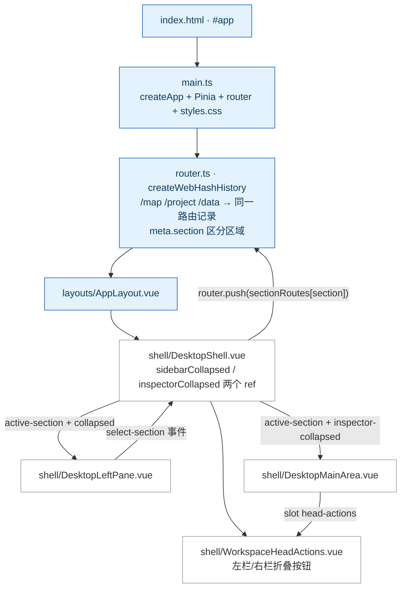
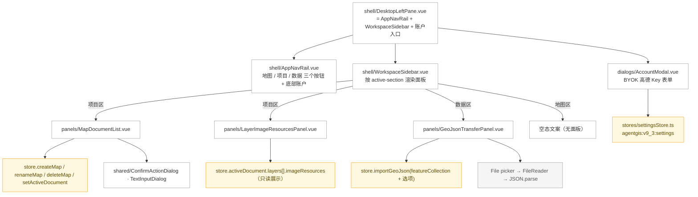
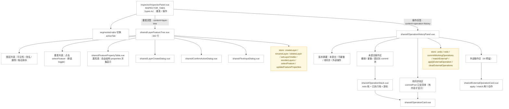
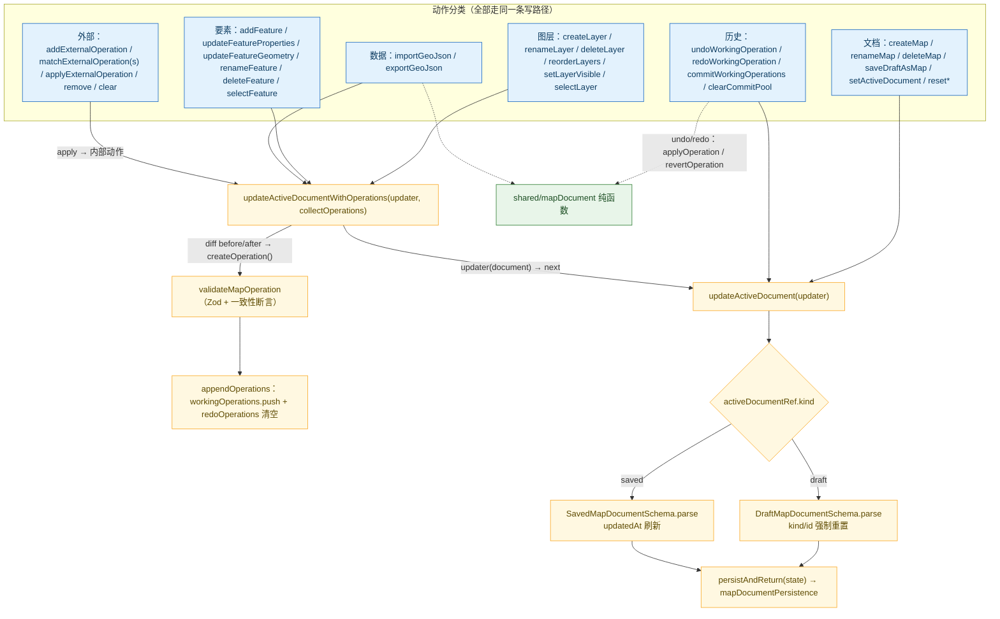
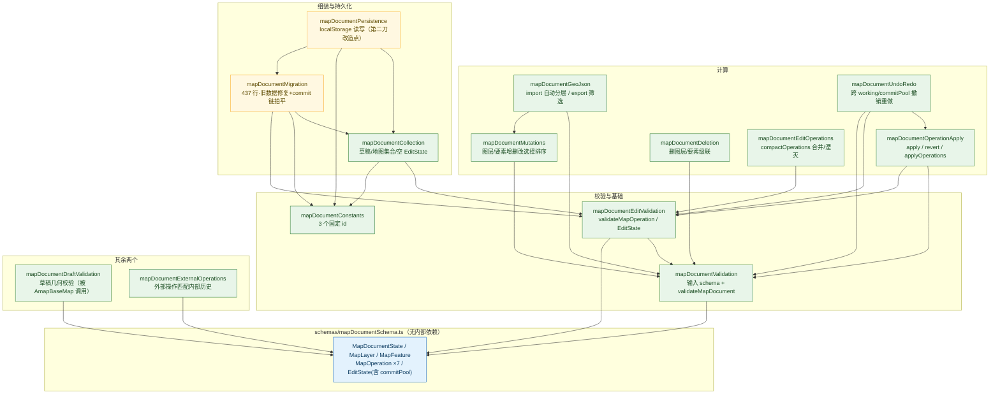
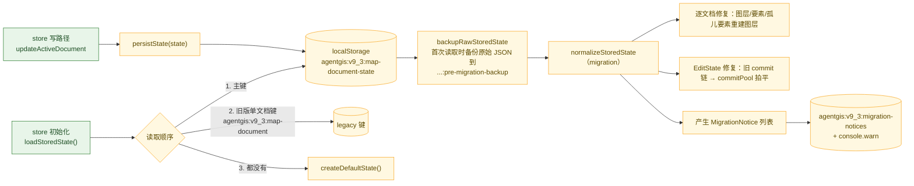
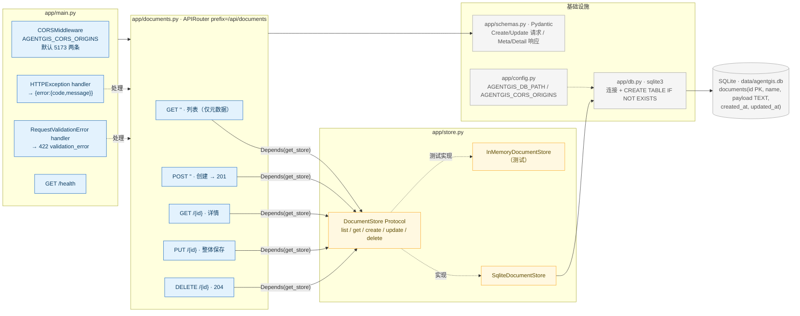
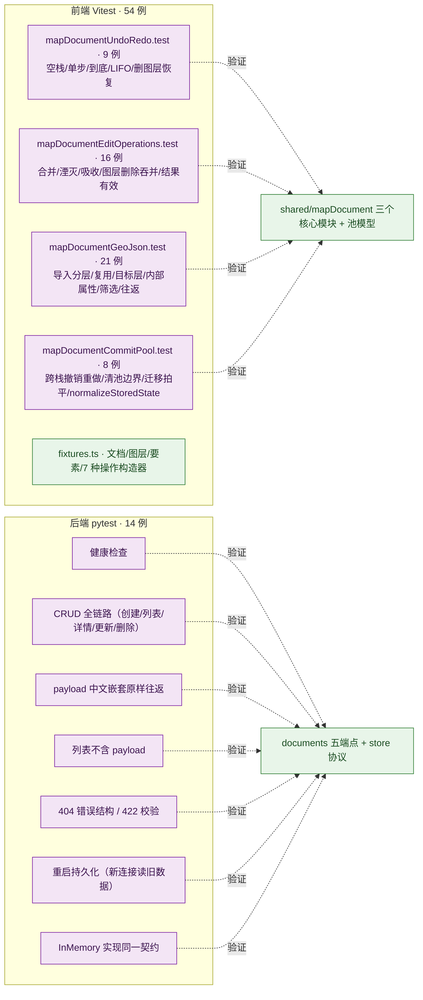

# AgentGIS 前后端详细架构（2026-11-20 现状）

> 前端 = `agentgis-frontend`；后端 = `agentgis-backend`（第一刀完成：文档 CRUD）。
> 按模块拆图：① 入口与布局 ② 左栏与面板 ③ 地图工作区 ④ 检查器 ⑤ store 编排 ⑥ 纯函数依赖 ⑦ 持久化与迁移 ⑧ 后端 ⑨ 旧后端参考 ⑩ 测试矩阵。

## ① 入口与布局

要点：路由是"一个记录三个区"——`meta.section` 是当前区的唯一真相；折叠状态是 `DesktopShell` 本地 ref，不进 store、不持久化。

## ② 左栏与面板（随导航区切换）

要点：侧栏面板全部是"薄层"——事件直抛 store，没有本地业务状态（除了 dialog 的开关与表单草稿）。原生 `FileReader`，不引第三方解析库；「导入图层」自动分层/复用逻辑在 store → `importGeoJson` 纯函数里。

## ③ 地图工作区（组件链 + 高德隔离层）

```mermaid
flowchart TB
    MW["map/MapWorkspace.vue<br/>v-model: mode / tool / mapAction"]
    MW --> MCB["map/MapCommandBar.vue"]
    MW --> AMAP["map/AmapBaseMap.vue · 491 行<br/>画布容器：挂载/销毁地图、监听 store 变化"]
    MW --> FRAME["map/MapBoundsFrame.vue + MapViewControls"]
    MCB --> MSEL["map/MapModeSelector.vue<br/>浏览/编辑/分析"]
    MSEL --> MTOOLS["map/MapModeTools.vue<br/>选择/绘制/导入"]
    MCB -->|"exportGeoJson() 全量导出"| ST["store.exportGeoJson → Blob 下载"]
    MCB -->|"save-draft 事件"| DSAVE["dialogs/DraftMapSaveDialog.vue"]

    AMAP --> LDR["shared/amap/amapLoader.ts<br/>动态注入 JSAPI script + Key/SecurityCode"]
    AMAP --> DRAW["shared/amap/amapDrawingSession.ts<br/>绘制状态机（point/line/polygon + MouseTool）"]
    AMAP --> EDIT["shared/amap/amapEditSession.ts<br/>几何编辑（拖拽节点）"]
    AMAP --> ADPT["shared/map/amapFeatureAdapter.ts<br/>Store 要素 ↔ AMap 覆盖物 双向绑定"]
    AMAP --> DRAFT["shared/amap/amapDraftGeometry.ts<br/>AMap 事件 → GeoJSON 草稿"]
    AMAP --> VALI["shared/mapDocument/mapDocumentDraftValidation.ts<br/>草稿几何校验：类型匹配/≥2 点/面积/自相交"]
    AMAP --> DOCK["map/MapDrawingDock.vue<br/>草稿确认/取消浮层"]
    AMAP -->|"提交"| ST2["store.addFeature / updateFeatureGeometry"]
    AMAP -->|"编辑目标计算"| GEA["shared/map/useGeometryEditTarget.ts<br/>mode+tool+选中要素 → geometryEditFeatureId"]

    classDef comp fill:#ffffff,stroke:#9e9e9e,color:#333;
    classDef amap fill:#e3f2fd,stroke:#1565c0,color:#0d3c61;
    classDef store fill:#fff8e1,stroke:#f9a825,color:#5d4a00;
    class MW,MCB,FRAME,MSEL,MTOOLS,DSAVE,DOCK comp;
    class AMAP,LDR,DRAW,EDIT,ADPT,DRAFT,GEA amap;
    class ST,ST2,VALI store;
```

要点：高德 SDK 完全隔离在 `shared/amap` 四个模块里，组件层只碰"会话对象"和 GeoJSON；绘制流程是 AMap 事件 → 草稿 GeoJSON（`amapDraftGeometry`）→ 校验（`DraftValidation`）→ `addFeature` 进 store。BYOK 的 Key 从 `settingsStore` 读，未配置时画布区显示提示而不是崩溃。

## ④ 检查器（两个页签）

要点：两个页签都直接读 `store.activeDocument.edit`；属性表利用 GeoJSON 自由结构，列 = 所有要素 properties 键的并集（与 WebGIS-Dev 同策略）。**多选不存在**（`selectedFeatureId` 单值）；**搜索框无逻辑**（`InspectorSearch` 只有输入框，已知 bug，未修）。

## ⑤ store 编排管线（38 个公开动作 → 一条写路径）

要点：**所有业务变更最终都收敛到 `updateActiveDocument` 一条写路径**——schema 校验、`updatedAt`、persistAndReturn 持久化只在这里发生一次。动作函数本身只负责"算 next document"和"生成操作"。第二刀接后端时，`persistAndReturn` 就是挂同步钩子的唯一位置。

## ⑥ mapDocument 纯函数依赖图（按真实 import 核实）

要点：依赖单向无环——`schema ← validation ← 计算 ← 组装/持久化`。`mapDocumentEditValidation` 是全校验的汇点；`mapDocumentPersistence` 是唯一碰外部环境（localStorage）的模块。

## ⑦ 持久化与迁移链路

要点：迁移是"读时修复"——不写回任何新格式，直到下一次业务变更才覆盖。三个 localStorage 键：主状态、迁移前备份、迁移通知。**第二刀只改这个图里 P1/P2 两层**（换成适配层），备份/通知不动。

## ⑧ 后端 agentgis-backend（第一刀现状）

要点：路由只依赖 Protocol（`Depends` 注入），换实现只动 `SqliteDocumentStore`。payload 是前端 MapDocument JSON 原样，后端不做业务解析。**第三刀**在 `spatial/` 下单开子包（单端点 + operation 分发 + Shapely），与 documents 完全解耦。

## ⑨ 旧后端 rag-agent v0.7（历史参考，不复活）

```mermaid
flowchart TB
    subgraph ENTRY["入口 app/main.py · 106 行"]
        M0["FastAPI · CORS 全开 · 静态托管 frontend/dist<br/>POST /api/retrieve（RAG 检索兼容端点）"]
    end

    subgraph APIL["api/ · 驱动适配器（4 路由 + 依赖注入 403 行）"]
        direction TB
        A1["project_api · 71 行<br/>GET/POST /projects · GET/PUT/DELETE /projects/{id}"]
        A2["map_api · 220 行<br/>POST /map/edit · /map/analyze-chat<br/>/map/import-amap · /map/reference-amap · GET /health"]
        A3["agent_api · 23 行<br/>POST /agent/run"]
        A4["chat_api · 32 行<br/>v0.7 新增"]
        A5["dependencies · 57 行<br/>DI 组装 EditMapService / JsonProjectStore"]
    end
    M0 --> A1 & A2 & A3 & A4
    A5 -.注入.-> A2

    subgraph SVC["services/ · 用例层（18 文件约 5100 行）"]
        direction TB
        subgraph AGENT["Agent 链路（红色=已放弃）"]
            S1["agent_graph · 581 行<br/>LangGraph StateGraph 8 节点<br/>load→context→intent→retrieval→workflow→persist→memory→final"]
            S2["agent_intent · 320 行<br/>LLM+规则双通道 6 意图分类"]
            S3["context_composer · 276 行<br/>4 模式上下文组装"]
        end
        subgraph EDIT["编辑链路（黄色=部分可借鉴）"]
            S4["edit_map_service · 541 行<br/>analyze/edit/import 三入口编排"]
            S5["llm_map_editor · 544 行<br/>LLM 生成 EditPlan"]
            S6["operation_executor · 347 行<br/>7 种 op 应用+校验（create_layer/add_features/draw_circle…）"]
            S7["amap_importer · 295 行<br/>高德 POI 抓取→MapFeature"]
            S8["geo_retrieval · 305 行<br/>空间检索工具包（bbox/附近/图层）"]
        end
        subgraph MEM["记忆系统（红色=已放弃）"]
            S9["conversation_memory · 163 行<br/>滚动摘要 3500字→1800字"]
            S10["memory_manager · 376 行<br/>三层记忆读写编排"]
            S11["memory_extractor · 216 行<br/>LLM 提取 6 类记忆候选"]
            S12["memory_policy · 145 行<br/>置信度策略/去重/衰减"]
        end
        S13["map_brief · 65 行 · 地图摘要"]
        S14["map_context · 210 行 · 上下文快照"]
        S15["mappers · 63 行 · schema↔dataclass"]
        S16["document_service · 180 行"]
        S17["indexing_service · 255 行 · 入库/切块/嵌入"]
        S18["query_service · 126 行 · RAG 查询"]
        S19["eval_service · 72 行 · 检索评估"]
        S20["trace_service · 52 行 · 调用追踪"]
    end
    A3 --> S1
    A2 --> S4
    A1 --> S16
    A2 --> S7
    S1 --> S2 & S8 & S10 & S17
    S4 --> S5 & S6 & S7
    S5 --> S2
    S10 --> S9 & S11 & S12

    subgraph DOM["domain/ · 领域核心（90 行，唯一干净的六边形部分）"]
        D1["map_document · 56 行<br/>MapDocument/Layer/Feature/Geometry/Viewport（dataclass 零依赖）"]
        D2["operations · 34 行<br/>MapOperation/OperationResult/EditPlan/EditStep"]
    end
    S6 --> D1 & D2

    subgraph ADAPT["adapters/ · 驱动适配器（642 行）"]
        AD1["llm_client · 113 行 · OpenAI 兼容 complete_json()"]
        AD2["json_project_store · 341 行<br/>项目整体存 JSON 文件·锁·workspace 过滤（绿色=策略可借鉴）"]
        AD3["amap_adapter · 188 行<br/>httpx 高德 geocode/POI（绿色=阶段 5 复用）"]
    end
    S5 & S2 & S11 --> AD1
    S10 & S1 --> AD2
    S7 --> AD3

    subgraph RAGL["RAG 链路（红色=已放弃）"]
        direction TB
        P1["processing/ · 6 文件<br/>loader/chunker/cleaner/differ/embedder/keyword_extractor"]
        R1["retrieval/ · 6 文件<br/>dense/sparse/fusion(RRF)/query_processor/query_rewriter/reranker"]
        T1["tools/rag_toolkit · 检索门面"]
        ST1["storage/ · 4 文件<br/>qdrant_store/chunk_reconstructor/document_registry/file_store"]
        QD2[("qdrant_data/ 本地向量库<br/>BGE-small-zh + bge-reranker 本地模型")]
    end
    S17 --> P1
    S18 --> R1
    M0 --> T1
    T1 --> R1
    S1 --> T1
    P1 --> ST1
    R1 --> ST1
    ST1 --> QD2

    FS[("data/documents/projects.json<br/>整文件 JSON 存储 + 线程锁")]
    AD2 --> FS

    classDef cut2 fill:#fbe9e7,stroke:#c62828,color:#5d1a12;
    classDef keep2 fill:#e8f5e9,stroke:#2e7d32,color:#1b4d22;
    classDef mid2 fill:#fff8e1,stroke:#f9a825,color:#5d4a00;
    classDef dom2 fill:#e3f2fd,stroke:#1565c0,color:#0d3c61;
    class S1,S2,S9,S10,S11,S12,P1,R1,T1,ST1,QD2 cut2;
    class AD2,AD3 keep2;
    class S4,S5,S6,S7 mid2;
    class D1,D2 dom2;
```

### 旧后端关键数字与归宿

| 部分 | 行数 | 归宿 |
|---|---|---|
| api/ 路由层 | 403 | `project_api` 的 CRUD 形状 → 我们 `documents.py` 已复刻；`dependencies.py` 的 DI 思路 → 我们 `Depends(get_store)` |
| domain/ | 90 | 纯 dataclass 模型，与前端 Zod 不兼容，**不迁移**；但其"domain 零外部依赖"原则我们照做 |
| adapters/ | 642 | `json_project_store` 的列表-详情分离、workspace 过滤 → 策略借鉴；`amap_adapter` → 阶段 5 演示数据抓取可直接搬（独立文件，无依赖牵涉） |
| services/ Agent+记忆 | 约 2400 | **全部放弃**（LangGraph、6 意图分类、三层记忆、滚动摘要） |
| services/ 编辑链 | 约 2000 | `operation_executor` 的 op 校验模式与圆形缓冲（haversine 圆环算法）→ 未来 bootstrap 参考；`llm_map_editor` 的 EditPlan→执行→校验 → 第 7 步 AI 薄接口的形态参考 |
| RAG 链路 | 约 1000+ | **全部放弃**（chunker/embedder/retriever/reranker/qdrant/BGE 本地模型） |
| 存储 | 1 个 JSON 文件 | 我们已换 SQLite 一张表 |

## ⑩ 测试矩阵

## ⑪ 读图要点

**前端**：

- 组件层只负责显示和事件；所有写操作收敛到 store → `updateActiveDocument` 单一写路径 → 持久化一次。
- `shared/mapDocument` 依赖单向无环：schema ← validation ← 计算 ← 组装/持久化。
- 高德 SDK 完全隔离在 `shared/amap`；组件层只碰会话对象与 GeoJSON。
- 唯一持久化出口是 `mapDocumentPersistence.ts`——第二刀只改这里。

**后端**：

- 第一刀结构：入口 → 路由 → Protocol → 实现 → DB；路由不知道底下是 SQLite 还是内存。
- payload 整块进整块出；`updated_at` 排序列表。
- 第三刀空间分析是独立子包；结果由前端作为一条 `geojson.import` 操作进现有管道。

**已知问题（未修，按用户优先级排）**：

- `InspectorSearch` 输入框无任何过滤逻辑（空壳）。
- 导出 GeoJSON 只支持全量（底层函数已有 layerIds/featureIds/role 筛选参数，UI 未接）。
- 无多选（schema 是单 `selectedFeatureId`，属 V2 的 L3 改动）。
