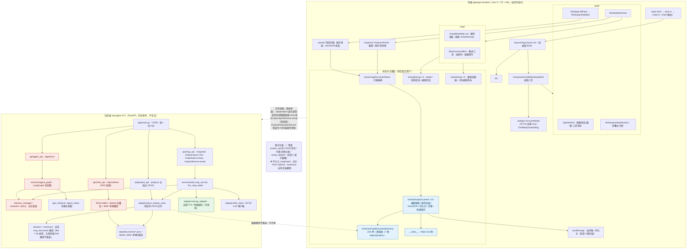
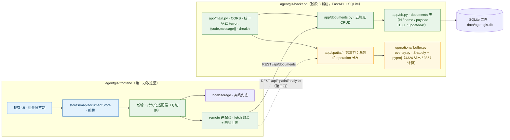

# 前端 × 旧后端架构关系图

> 2026-11-19 · 上半为现役前端 `agentgis-frontend` 模块树；下半为旧后端 `rag-agent v0.7`（历史参考，不复活）。
> 绿色 = 可借鉴（CRUD 形状 / amap 适配器）；红色 = 明确砍掉的 LangGraph、记忆、RAG 链路。
> 用支持 Mermaid 的查看器打开即可渲染：VS Code（Markdown Preview Mermaid 插件）、Typora、GitHub 网页直接看。

## 阶段 3 目标形态：新后端 agentgis-backend（待实现）

> 第一刀（文档 CRUD）只建左侧「API 层 + SQLite」；`spatial/` 为第三刀预埋的占位结构。
> 与旧后端的根本差异：payload 原样存前端 MapDocument JSON、无 LLM/记忆/RAG、分析师无状态算子。

**三刀对应关系：** 第一刀只做 `MAIN + DOCS + DB`（绿色）+ pytest；第二刀做前端适配层（`PERSIST + REMOTE`），localStorage 降级保留；第三刀做 `SP + OPS`（黄色）。

**测试计划：** 第一刀 pytest 约 12 例（CRUD 往返 / 404 / 列表不带全量 payload / 重启后数据仍在）；第二刀 Vitest 约 6 例（mock fetch：成功 / 404 / 网络失败降级 / 超时）；第三刀 pytest 数学验证（buffer 面积 ≈ πr²、overlay 手算核对）。

**明确不做：** 鉴权、提交同步、冲突合并（v1 最后写入者赢）、数据库恢复、LLM。

## 读图要点

- **前端五大组件分组**（shell / map / panels / inspector / dialogs）挂在 `AppLayout` 下；组件只依赖 stores，计算下沉到 `shared/` 纯函数层。
- **状态与计算层是资产**（蓝色）：Zod schema 单一真相源、mapDocument 纯函数模块、113 例测试。
- **旧后端四路由**：`project_api` 的 CRUD 形状可借鉴；`map_api` 是当年 AgentGIS 真后端接口（依赖 LLM 编辑与记忆）；`agent_api` 的 LangGraph 状态图、RAG 检索链路全部砍掉（红色）。
- **两条虚线**是历史事实而非运行链路：前端部分调用过旧后端接口；旧后端自有文档模型与现前端 Zod 模型不兼容、不迁移。
- 阶段 3 后的目标形态：`ST3 → LS` 那条边改为「ST3 → 持久化适配层 → REST → agentgis-backend → SQLite」。
